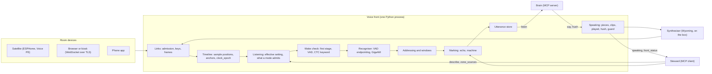

# The reference voice front — design

Classification: **architectural**. Nothing of the voice front exists in this repository. It is a
new subsystem that meets the steward (as a `front` client) and the brain (as the front's MCP
server), and it is graded by [`standard/voice.md`](https://github.com/Ludentes/galatea-life-standard/blob/main/standard/voice.md) 0.1.

## Rulings it stands on

- **Everything Python** (the maintainer, 2026-09-27): the whole front, not only its speech service.
  It is the one reference build outside the TypeScript rule. It meets every other build only over
  the wire, as they all do.
- **Seeded from an ASR sidecar**, `voice-asr`, which the maintainer released under Apache-2.0
  (2026-09-27), then changed until it follows the standards.
- **This front is upstream** (the maintainer, 2026-09-27): other products are to reuse what this
  repository publishes rather than grow their own. So the front stays free of Galatea-only
  assumptions where the standard does not need them: the wake word, the models, the synthesiser
  and the links are configuration.
- **Wake detection on the device or on the server, per endpoint.** The device is tuned for recall
  and the server gives the precision. Galatea's voice standard already has the modes
  (`listening`: `off`, `tap`, `wake_device`, `wake_server`).
- Live audio may cross the home's LAN to its own box. ⛔ No audio, no voice profile and no model
  trained on one person's voice enters this repository.
- The wake word is configuration, chosen at provisioning.

## The listening modes

The front is one server pipeline with a listening mode per endpoint:

| `listening` | What leaves the room | What addresses |
|---|---|---|
| `off` | nothing | nothing |
| `tap` | a tap window, with a 1 s pre-roll for speech detection only | one utterance starting in the window |
| `wake_server` | all speech | an utterance the server's cascade confirmed |
| `wake_device` | windows the device's own model opened | a window the server confirmed |

Two things make it "the best of both worlds":
- **One server check confirms both wake modes.** At `wake_device` the satellite runs a
  recall-tuned microWakeWord pair (budget: under 50 false wakes an hour, either model firing) and
  sends the window around its event; at `wake_server` the server runs its own first stage over
  all speech. Either way, Silero VAD then GigaAM's CTC keyword score, at a word boundary, over
  [t − 2.0 s, t + 0.3 s], decides. Measured on field recordings of an earlier wake word, a pair at
  0.9 with the liaison keywords catches 79 of 89 real wakes at 0.27 false wakes an hour or less; a
  licence-clean pair catches 77 of 89.
- **The mode is the owner's per endpoint**, so a bedroom can run `wake_device`, a kitchen
  `wake_server` and a hall `tap`, with the same front.

What the design decides:
- **The steward is the authority.** The front reads the voice records from the steward's
  `describe`, waiting on the next revision (`wait_s`), so a narrowing lands within the narrowing
  delay (2 s), not at a poll's next tick. A widening needs no reconnect.
- **No mode that passes everything on.** Transcribing and passing on everything with no
  addressing is not a Galatea mode, and the seed's environment-variable gate goes with it: a front
  with no setting and no steward listens nowhere (GA-VOICE-3), which is the gate.
- **No field capture.** The seed's archive, cue channel and arm registry existed to record
  experiments, rejected speech included. GA-VOICE-15 allows audio only of delivered utterances,
  for `audio_retention_s` (none by default). Field experiments are not the front's job.
- **Every device link is authenticated and encrypted** (GA-VOICE-13, GA-VOICE-17), loopback
  included for the key. Each device has its own key, bound to one endpoint, not a shared stream
  token.
- **Follow-up windows exist at level Converse.** Measured in the field they cost 0.54 false
  accepts an hour for commands, so the standard allows them only where the owner turns
  `follow_up` on, and caps what a follow-up may answer (steward, GA-CONF-6).
- **The transcript rule addresses at `wake_server`**, not only the cascade. Galatea's standard
  allows `transcript` as a word's model, and it is the only check «Галатея» has today.
- **The wake rule is data.** The seed hard-coded its word, with a phonetic branch tuned on it.
  The front reads each endpoint's `wake_words` (GA-VOICE-4).

## ⚠️ One conflict with the standard: the window's length

The device firmware the server check was measured with sends [t − 2.0 s, t + 0.3 s] around its event, where t is where the model fired,
near the end of the word. The server's check was measured on that window. The voice standard
caps the pre-roll at 1 s before the word (*Constants*, GA-VOICE-1). For a word of about 0.7 s
(«Галатея»), 2.0 s before t is about 1.3 s before the word.

The word's onset is known only once a model has run, so the front cannot cut at it. The design
cuts **before any model runs**, at a fixed offset from the device's event. The cut applies only at
`wake_device`: at `wake_server` there is no device event, and the front's own speech detection
bounds the window. It reads
[t − H, t + 0.3 s], where H is 1 s plus the shortest duration of the word on its model card, and
counts every earlier frame `discarded`. A word said at least that long then has at most 1 s before
it. The check MUST accept any head from the minimum pre-roll (0.3 s) up, since the harness's fake
device sends only what the standard allows.

**Where the shortest duration comes from.** It belongs to the device's model, the one that fired.
GA-VOICE-18's card has no field for it, so the front's declaration of that model carries it
beside the card: the shortest positive in the card's calibration pool, measured from the word's
aligned onset to its end. The front does not load a device model whose declaration lacks it, and
`wake_device` then falls back as the standard's `no_model` does. Adding the field to the card is
a candidate for the next voice revision.

Three things stay open:
- Whether the check loses recall with this shorter head is **unmeasured**.
- A word said faster than its card's shortest duration leaves slightly more than 1 s before it.
  The standard measures the pre-roll from the word's onset, which no front can find before a model
  runs. Measuring it from the device's event is a candidate for the next voice revision, through
  the standard-review skill.
- A word said slowly loses its head. When it lasts more than the shortest duration plus 0.7 s,
  less than the minimum pre-roll is left before it, and the wake is unconfirmed (GA-VOICE-4); past
  H, the cut clips the word's start. Whether slow speakers lose recall this way is unmeasured, and
  stage 4 records the longest positive in the calibration pool beside the shortest.

## Approaches considered

**A. A front grown from the sidecar, one process, pure cores behind thin adapters** (chosen).
- The rules the standard grades (what a mode admits, addressing, the effective setting, echo and
  machine matching, the timeline and its epochs, which window is open) are pure functions with no
  socket, clock or model, as the seed's `addressing.py` already is. Each is tested as a table.
- The links, the steward client, the brain server, the models and the synthesiser are adapters
  around them.
- Audio and the clock live in one process, which the timing rules want (sample positions,
  anchors, a barge-in's cut).

**B. The sidecar kept as a speech service, a separate front process over Wyoming.** Rejected. It
puts a process boundary in the middle of the timing rules. Wyoming stays available for what the
standard allows on one host: a synthesiser or a recogniser the owner installs.

## Architecture

### The package

`reference/voice-front/`, its own uv project (Python 3.11, as the sidecar's `sherpa-onnx` needs).
It imports nothing from another build, and validates its messages against [`conformance/schemas/`](https://github.com/Ludentes/galatea-life-standard/tree/main/conformance/schemas)
as JSON Schema, without the TypeScript types.

| Module | Holds | From the sidecar |
|---|---|---|
| `text.py` | The standard's normalisation (NFKD, confusables, digits as words, `ё` as `е`), word overlap, edit distance to the closest run of whole words, the whole-word wake-word test | `normalise`, `lev` from `trigger.py`, rewritten to the standard's rules |
| `listening.py` | The effective setting (configured, narrowed by every narrowing, by mute, offline and `no_model`), with its reason; `admits(mode, window)`; `may_address(mode, by)`; the last setting kept on disk | new |
| `timeline.py` | Sample positions, the anchor over the anchor window, buffered stretches, the monotonic-to-wall mapping, `clock_epoch` persisted and never reused | new; the seed's speech-end fix |
| `speech/vad.py`, `speech/asr.py` | Silero endpointing, GigaAM-v3 CTC decoding | `asr.py` |
| `wake/` | The wake check: a first-stage seam (none, or a microWakeWord model run in float), Silero at the event, the CTC keyword score with a word's liaison forms, the transcript check; the models it holds, declared with `measured` | new |
| `addressing.py` | `addressed_by` from what opened the utterance; tap windows with the pre-roll in-progress rule; later the follow-up and barge-in windows | `addressing.py` |
| `echo.py` | Echo and machine marking: overlap on the front's clock and matching words, copies of echoes, the source-delay hold | new; the seed's `marking.py` (the browser's playback frames, marked for measurement) goes with the link in stage 2d |
| `speaking.py` | `Speaking`, the brain server's `Speech`: a lane per endpoint in arrival order, reply chains by `continues`, `played` filed once by a reporter, `hush` and `cut`, the wake-word guard at `say`, synthesis and play, the silent-brain clip, `speaking` to the steward by a teller per endpoint, and `PlayLog` for echo; `Player` is the link's seam | new |
| `synth.py` | The Wyoming client: one whole piece, or `SynthFailed`; the synthesiser is on this host | new |
| `clips.py` | The installation's fixed clips: 16-bit WAVs outside the repository, their texts declared and checked for wake words | new |
| `store.py` | Utterances and `played` reports for the brain, kept across restarts (Postgres, schema `voice_<id>`, at least 3600 s); audio only under `audio_retention_s`, as files under `audio_dir` | new |
| `links/browser.py` | WebSocket over TLS, a key per device, bound to one endpoint, the tap and pre-roll frames | the `/stream` protocol, reworked |
| `links/esphome.py` | The ESPHome native API with its encryption key, the front as the client, as Home Assistant is | new, after the spike below |
| `steward.py` | The MCP client: `describe` with `wait_s`, `zone_sources`, `narrow`, `front_status`, `speaking`; the front's view of `describe`; the watch on it; the log of machine speech on the front's clock | new |
| `brain.py` | The MCP server: `listen`, `say`, `hush`, each brain's bearer credential bound to its endpoints; delivery by `served_by`; `say` and `hush` handed to speaking | new |
| `schemas.py` | [`conformance/schemas/`](https://github.com/Ludentes/galatea-life-standard/tree/main/conformance/schemas), loaded by `$id`, checked on every message | new |
| `mcpwire.py` | MCP as the standards bind it: tools with the operations' schemas, bearer credentials, revision `2026-07-28` served and used, and the older handshake only as GA-VOICE-21 allows | new |
| `serve.py` | TLS for both links; serving the brain server | new |
| `app.py`, `config.py` | Composition; the configuration file (credentials, device keys, model paths, the synthesiser's address) | `server.py`, reduced |

Dropped from the copy: `archive.py`, `archive_contract.json`, `control.py`, `arms.py`,
`levels.py`, the deploy scripts, the command-extraction tool, and the tests that cover them.
`selfcheck.py` stays as a manual tool that runs a WAV from outside the repository.

### An utterance, end to end

1. A link admits a device by its key and binds it to one endpoint. Before admission nothing is
   read (GA-VOICE-17).
2. Each frame is placed on the timeline and offered to `listening.admits`. A frame not admitted is
   counted `discarded` and dropped; one admitted is counted `read`.
3. At `tap` the window's audio goes to the recogniser. At `wake_server` all speech goes to the wake
   check. At `wake_device` the device's window goes to the wake check. The pre-roll reaches only a
   second VAD, for the in-progress rule, and the first 1 s before the word only the check.
4. A confirmed or tapped utterance is transcribed and addressed. Every other transcript is dropped
   unread.
5. Marking holds an utterance that begins with a wake word, or has at least three words, until
   one second after its speech began, then marks it `echo` or `source: machine`, or neither.
6. The utterance gets a UUID, `time` and `clock_epoch`, goes into the store, and is delivered to
   the brain the endpoint's `served_by` names, and only to it.

### Speaking

A `say`, and every fixed clip at startup, is checked against every endpoint's wake words and the
home's `other_wake_words` before it is synthesised or played (GA-VOICE-20). It is synthesised by the configured synthesiser, played at the endpoint, logged
for echo marking with its text and interval, and reported `played`. While it speaks at an endpoint, the
front sends `speaking { on: true }` at the start and again every half of the steward's duck limit,
and `on: false` at the end (GA-VOICE-12). The front plays no other words than the brain's and its
fixed clips. The clips are WAV files the installation supplies,
outside the repository, with their texts declared in `front_status`.

The synthesiser is **configuration, not a dependency**: the front speaks Wyoming to a TTS service
on the box. Which one is the owner's, and the licence question stays open (Silero is
non-commercial, Piper is GPL-3.0 with one CC BY-NC-SA voice). Nothing is bundled.

### Models

Models are files outside the repository, fetched by a script, as the sidecar does today
(`fetch-models.sh`: GigaAM-v3 CTC and Silero VAD). ⚠️ The server check was measured on Silero v6; the
sidecar's `silero_vad.onnx` is of unknown version. The fetch pins v6.

Each wake model the front holds is declared in `front_status` with its `measured` numbers
(GA-VOICE-18), from a model card beside the model file.
A word with no model the box or the device can run falls back as the standard says: at
`wake_server` to the transcript check, at `wake_device` to `tap`, with the reason `no_model`.

**What the record carries.** A wake word is `{ word, model }`, where `model` names a wake model
or is `transcript` (steward, *Listening*):
- `transcript`: the recogniser transcribes every speech segment at `wake_server`, which the
  standard admits for the wake check, and the transcript check decides; every other transcript is
  dropped unread. It declares no model. The reason is `configured`.
- A named model: the CTC keyword check, alone or behind a first stage, declared in `front_status`
  with its card (GA-VOICE-18). The reason is `configured` if the box or the device can run it, and
  `no_model` with the standard's fallback if not.

The CTC keyword check becomes a named model only once its card is measured by the standard's
procedure. Until then, a keyword check without a first stage would score every speech segment,
which costs as much as transcribing it, so the first release does not offer one.

**For «Галатея» today** there is no device model that may ship. Round three's TTS-trained model
caught 0 of 80 of the maintainer's takes. The models trained on clones of that voice caught 54 of
80, but a model trained on one person's voice never enters this repository. The transcript rule
is the
operating choice: Galatea's own rule (`greet_hit_v2`) caught «Привет, Галатея» in 34 of 40 takes
(20 of 20 at 1 m, 14 of 20 at 3 m), with no false wakes in 54.5 hours, **in-sample**. So the
first release runs
`wake_server` with `model: transcript`, and `wake_device` waits for a licence-clean device model.

## Error handling

| Failure | Behaviour | Requirement |
|---|---|---|
| Steward unreachable | Keep the last setting read, never widen it; the effective reason is `no_steward` while it is lost, and the first `front_status` after it returns reports that and the current reason | GA-VOICE-2, GA-VOICE-3 |
| Started with no setting and no steward | Listen nowhere | GA-VOICE-3 |
| A device goes offline, or its mute is pressed | The endpoint is `off`, reason `offline` or `muted` | GA-VOICE-2 |
| A narrowing mid-utterance | The utterance is dropped unread; the new setting applies from the next frame | GA-VOICE-3 |
| Wall clock steps or drifts past the tolerance | A new mapping, `clock_epoch` counted up and persisted | GA-VOICE-8 |
| The brain says nothing | «Не могу ответить» once, after the failure bound plus the clip slack | GA-VOICE-11 |
| A `say` contains a wake word | Not played; `played` `dropped`, `reason: wake_word` | GA-VOICE-20 |
| The synthesiser fails | The piece is `dropped`; the silent-brain clip still applies | GA-VOICE-10, GA-VOICE-11 |
| A link fails admission | Nothing read; closed after 5 s | GA-VOICE-17 |

## Testing

Tests first, and each names the change that would make it fail.
- **Pure cores as tables**: `admits`, `may_address`, the effective setting, addressing, the
  normalisation and the matches (including «да» never inside «когда»), the anchor and the
  epochs, window rules. No models, no audio.
- **The seed's tests**: the addressing and playback tests, rewritten to the standard's rules;
  `trigger.py`'s golden cases become cases for a configured word.
- **Protocol tests** against a fake steward and a fake brain in the package's tests: narrowing
  within 2 s, `front_status`, `speaking`, `listen` and `say`, credentials bound to endpoints.
- **Audio tests** need the fetched models and synthesised speech, never committed audio; they are
  marked and skipped without them.
- **Grading** is the voice harness's ([`standard/voice.md`](https://github.com/Ludentes/galatea-life-standard/blob/main/standard/voice.md), *Conformance*): fake devices, a fake
  steward and brain, restarts, stalls and clock steps. It is built on the TypeScript harness core
  by the voice workstream, as a spec of its own. The front's own tests do not replace it.

## Spike before the satellite link

Nobody has verified this yet, and it decides `links/esphome.py`:
- Whether a client other than Home Assistant can drive stock ESPHome firmware on a Voice PE over
  the native API with `aioesphomeapi` (the library Home Assistant uses): take its wake event, its
  audio, and play a reply.
- Whether stock firmware can send the word's audio and at least 0.3 s before it. If it cannot, the
  endpoint is `no_model` at `wake_device` (GA-VOICE-4) until an ESPHome external component sends
  it.
- Whether its echo cancellation works; one contested report says it does not.

The spike runs on the maintainer's Voice PE units, and its answer is written up before the link is
designed.

## Stages

Each stage is its own plan, tests first, and each ends with the front's tests green.

1. **The seed.** Bring `voice-asr`, with its speech-interval fix, into `reference/voice-front/`;
   strip its references to the product it was written for and the dropped modules; the package
   layout above; the configured wake word in place of the hard-coded one. Tests green,
   with no behaviour a standard grades yet.
2. **Listen over the browser link.** The steward client and the brain server; the effective
   setting and narrowing; `tap` and `wake_server` with the transcript check (the CTC keyword
   scorer is built in stage 4, as the confirmation behind a device's first stage); the
   timeline and epochs; echo and machine marking; speaking through a synthesiser, the clips, the
   guard, `played` and `hush`; `front_status`; the store and retention; admission and TLS.
   Four plans: 2a the pure cores; 2b the steward client, the brain server and the store; 2c
   speaking; 2d the link, the endpointer on sherpa's own segment bounds, and the composition.
3. **The skill ingress** (GA-VOICE-16), which completes level Listen: the front then claims
   Listen.
4. **The satellite link and `wake_device`**, after the spike.
5. **Converse**: follow-up and barge-in windows, conversations.
6. **Zone**: merging.

The ingress is a MAY in the prose, but GA-VOICE-16 is a Listen MUST in the index. The standard
does not say whether a front without an ingress passes it, so the front builds one rather than
lean on either reading. Whether GA-VOICE-16 applies to a front without an ingress goes to the next
voice revision.

## Speaker hints

The front holds no gate models, so it sends no `speaker_hint` except `person` at an endpoint that
has its own person (GA-VOICE-14), and has no enrolled voice to delete (GA-VOICE-15). A gate model
is later work.

## What this does not decide

- The synthesiser, and its licence (open).
- The wake models' training: it stays outside this repository, and Galatea receives only
  licence-clean models with their cards.
- The voice harness (its own spec).
- Constants: the front uses the standard's; measuring them in the flat is later work.
